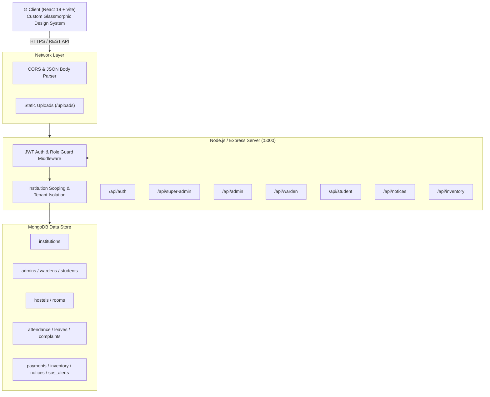

# 🏗️ Architecture Design Document (ARCHITECTURE.md)

## System: CampusHome Full-Stack MERN Platform
**Architecture Paradigm:** Client-Server Monorepo / Layered Multi-Tenant RESTful Architecture

---

## 1. High-Level System Topology



---

## 2. Monorepo Directory Organization

```
hostel-management-system/
├── client/                     # Frontend Single Page Application (SPA)
│   ├── index.html              # HTML5 entry with Google Fonts
│   ├── vite.config.js          # Vite build & proxy configuration
│   ├── package.json            # React 19, Lucide-React, React Router v7
│   └── src/
│       ├── main.jsx            # React root DOM rendering
│       ├── App.jsx             # Router definition & ProtectedRoute guards
│       ├── App.css             # Component-level styling overrides
│       ├── index.css           # Global Design Tokens & Glassmorphic CSS System
│       ├── api/                # Axios instance with auth interceptors
│       ├── context/            # AuthContext, Global State & Session storage
│       ├── components/         # Atomic & compound UI components
│       │   └── common/         # Navbar, StatsCard, Modal, Badges
│       └── pages/              # Role-specific application views
│           ├── LandingPage.jsx             # Public SaaS marketing portal
│           ├── LoginPage.jsx               # Universal 1-click auth portal
│           ├── super-admin/                # Platform tenant administration
│           ├── admin/                      # Institution Admin & Ops dashboards
│           ├── warden/                     # Hostel Warden operations center
│           └── student/                    # Student self-service dashboard
│
├── server/                     # Backend REST API Service
│   ├── server.js               # Express application bootstrap & route mounting
│   ├── seed.js                 # Database seeding fixture generator
│   ├── config/
│   │   └── db.js               # Mongoose MongoDB connection client
│   ├── middleware/             # Middlewares (Auth, Roles, File Uploads, Errors)
│   ├── models/                 # Mongoose ODM Schema Definitions (20 Schemas)
│   ├── routes/                 # Express API Endpoint definitions
│   ├── controllers/            # Controller business logic & data transformations
│   ├── utils/                  # Geofence calculator, token signer, helper utilities
│   └── uploads/                # Static asset uploads & avatars
│
├── PRD.md                      # Product Requirements Document
├── ARCHITECTURE.md             # System & structural architecture
├── RULES.md                    # Engineering standards & conventions
├── DESIGN.md                   # Visual system & styling specifications
├── TASKS.md                    # Roadmap & engineering breakdown
└── MEMORY.md                   # System status & memory state
```

---

## 3. Multi-Tenant Hierarchy

Every entity in CampusHome resolves under a strict multi-tenant boundary:

```
Platform (Super Admin)
  └── Institution (University / College / Boarding Group)
        ├── Institution Admin(s)
        ├── Hostel Building(s)
        │     └── Room(s)
        │           └── Resident Student(s)
        ├── Hostel Warden(s) [Assigned to 1 or more Hostels]
        ├── Attendance Records & Sessions
        ├── Complaints / Grievance Tickets
        ├── Leave Requests & Passes
        ├── Fee Invoices & Payment Transactions
        ├── SOS Emergency Alerts
        └── Inventories & Asset Registries
```

---

## 4. Backend Architecture & Core Components

### 4.1 Middleware Pipeline
1. **CORS & JSON Parsing**: Strict origin filtering with credentials support.
2. **Authentication Middleware (`protect`)**: Extracts Bearer token, verifies signature using `JWT_SECRET`, decodes role and identity, and attaches user record to `req.user`.
3. **Role-Based Access Control (`authorize(roles...)`)**: Guards protected administrative operations against unauthorized role elevation.
4. **Tenant Isolation Enforcement**: Controllers automatically filter queries via `req.user.institutionId` to prevent data leakage across distinct educational institutions.
5. **Centralized Error Handler (`notFound`, `errorHandler`)**: Catches asynchronous exceptions and surfaces standardized JSON responses:
   ```json
   {
     "message": "Descriptive error message",
     "stack": "Included only in development environment"
   }
   ```

### 4.2 Data Models & Schema Matrix
The system relies on 20 interconnected Mongoose models in `server/models/`:

- **Identity & Accounts**: `Institution`, `Admin`, `Warden`, `Student`
- **Hostel Infrastructure**: `Hostel`, `Room`, `RoomRequest`
- **Daily Operations**: `Attendance`, `AttendanceSession`, `LeaveRequest`, `MessMenu`
- **Safety & Care**: `SosAlert`, `Complaint`, `Notification`, `Notice`
- **Financials & Logistics**: `Payment`, `InventoryItem`, `InventoryLog`, `InventoryChecklist`, `SystemLog`

---

## 5. Frontend Architecture & Flow

### 5.1 Route Guards & Protection Pattern
Routes in `client/src/App.jsx` are wrapped inside `<ProtectedRoute allowedRoles={[...]}>`:
- Unauthenticated requests bounce immediately to `/login`.
- Authenticated users attempting to access unpermitted routes are automatically redirected to their native dashboard role (e.g. `/student`, `/warden`, `/institution-admin`, or `/super-admin`).

### 5.2 Geofencing Algorithm (Client + Server Verification)
1. Student triggers GPS attendance check-in.
2. Browser `navigator.geolocation.getCurrentPosition` extracts `latitude`, `longitude`, and `accuracy`.
3. Coordinates are transmitted to `/api/student/attendance/geofence`.
4. The backend applies the **Haversine Great-Circle Formula**:
   $$d = 2R \cdot \arcsin\left(\sqrt{\sin^2\left(\frac{\Delta\phi}{2}\right) + \cos(\phi_1)\cos(\phi_2)\sin^2\left(\frac{\Delta\lambda}{2}\right)}\right)$$
5. If calculated distance $\le$ `hostel.geofenceRadius` (in meters), the attendance is committed with a `verified` flag.

### 5.3 Real-Time SOS Dispatch Pattern
1. Student clicks high-contrast **🚨 SOS DISTRESS** button.
2. An emergency payload is created with student contact, current assigned room, and active timestamp.
3. Backend sets status to `active` and surfaces this in the Warden and Admin emergency monitors.
4. Warden can acknowledge, trigger security contact protocols, and resolve with an incident summary.
